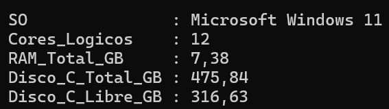
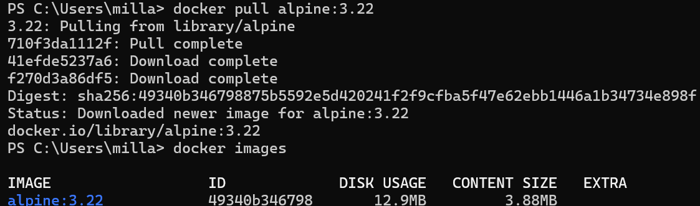
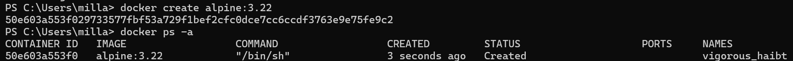
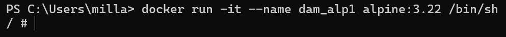
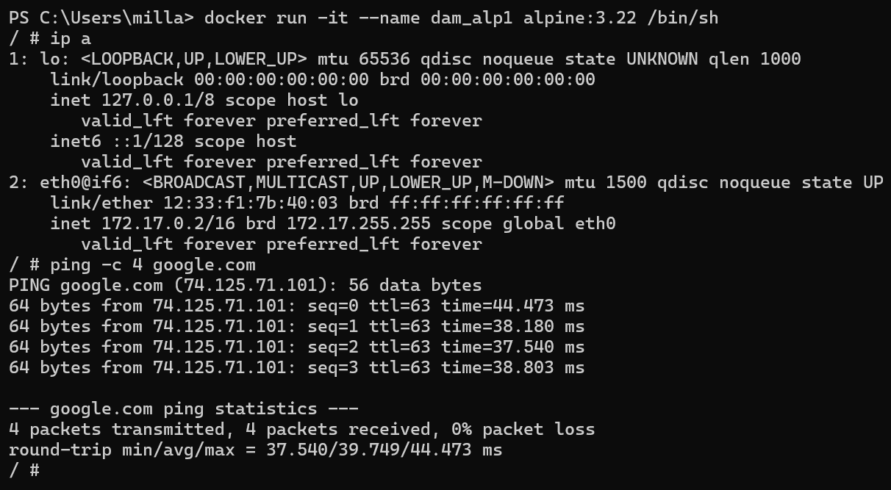
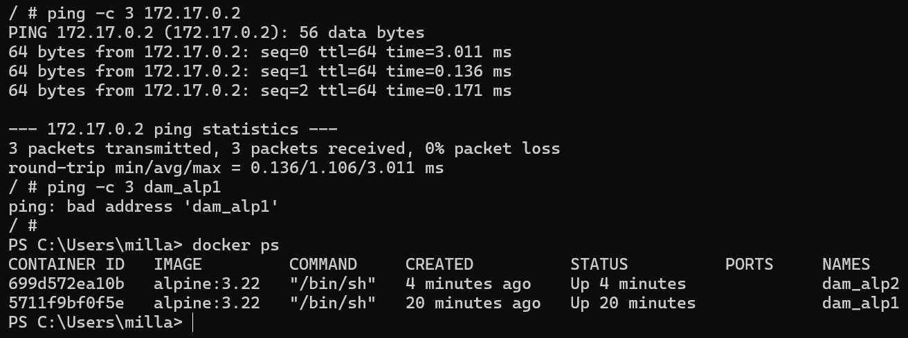
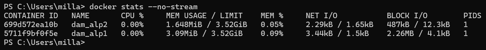
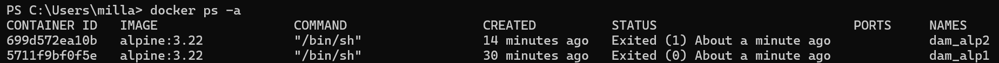
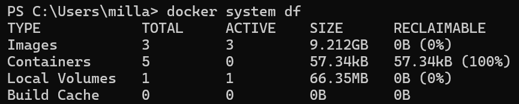

# Tarea 03 - Primeros pasos con Docker

- **Módulo:** Sistemas de Xestión Empresarial (SXE)
- **Ciclo:** CFGS DAM 2 (Curso 2026-2027)
- **Alumno/a:** Manuel Felipe Millán Peláez

---

## 0. Entorno de trabajo

Antes de comenzar con la práctica, se detallan las características del sistema anfitrión utilizado:



---

## 1. Descarga de la imagen de Alpine y comprobación

Descargamos la imagen oficial de Alpine fijando la versión `3.22` sin crear ni arrancar ningún contenedor, y verificamos que se encuentra almacenada en local:

```bash
docker pull alpine:3.22
docker images
```

**Justificación de la versión:** Es fundamental especificar la etiqueta de versión (`3.22`) en lugar de omitirla. Si no se indica etiqueta, Docker asume `latest` por defecto, lo que provoca que la imagen base pueda cambiar de versión en el futuro sin previo aviso, rompiendo la reproducibilidad del entorno.



---

## 2. Creación de un contenedor sin nombre y sin arrancar

Creamos un contenedor a partir de la imagen descargada sin asignarle nombre ni iniciarlo, y listamos todos los contenedores del sistema (incluidos los detenidos):

```bash
docker create alpine:3.22
docker ps -a
```

- **¿En qué estado queda?** El contenedor queda en estado **`Created`**, a la espera de recibir una instrucción `docker start`. Para poder visualizarlo es obligatorio añadir el parámetro `-a` a `docker ps`, ya que por defecto solo lista contenedores en ejecución.
- **¿Qué nombre le ha puesto Docker?** Al no utilizar el parámetro `--name`, Docker le ha asignado automáticamente un nombre aleatorio compuesto por dos palabras separadas por un guion bajo: **`vigorous_haibt`**.



---

## 3. Creación y arranque de `dam_alp1` con una shell

Creamos e iniciamos el contenedor `dam_alp1` accediendo directamente a su intérprete de comandos:

```bash
docker run -it --name dam_alp1 alpine:3.22 /bin/sh
```

- **¿Qué opciones necesitas para poder escribir dentro?** Se necesitan los modificadores **`-i`** y **`-t`** (combinados como `-it`):
  - **`-i` (interactivo):** Enlaza la entrada estándar (`stdin`) de nuestra terminal con el proceso del contenedor para que reciba las pulsaciones de teclado.
  - **`-t` (TTY):** Asigna una pseudoterminal para poder operar desde la consola.
  - _Nota:_ Al tratarse de Alpine (una distribución minimalista), no incluye `bash`, por lo que se invoca `/bin/sh`.



---

## 4. Comprobación de IP interna y conectividad con `google.com`

Desde el interior de la shell de `dam_alp1`, consultamos su configuración de red y probamos la salida a Internet:

```sh
ip a
ping -c 4 google.com
```

- **Dirección IP asignada:** En la interfaz `eth0` el contenedor tiene asignada la dirección **`172.17.0.2`**, perteneciente a la subred `172.17.0.2/16` de la red `bridge` predeterminada de Docker.
- **Conectividad exterior:** El ping a `google.com` responde correctamente (`0% packet loss`). Docker enruta el tráfico saliente del contenedor hacia el exterior mediante NAT a través de la interfaz virtual `docker0` del equipo anfitrión y utiliza su resolución DNS.



---

## 5. Ejecución simultánea de `dam_alp1` y `dam_alp2` (Ping por IP y por nombre)

1. Salimos de `dam_alp1` sin detener su ejecución pulsando la secuencia **`Ctrl + P`** seguida de **`Ctrl + Q`**.
2. Creamos y arrancamos un segundo contenedor llamado `dam_alp2` con las mismas opciones:

```bash
docker run -it --name dam_alp2 alpine:3.22 /bin/sh
```

3. Desde el interior de `dam_alp2`, realizamos las pruebas de conectividad hacia `dam_alp1` tanto por dirección IP como por nombre de contenedor:

```sh
ping -c 3 172.17.0.2
ping -c 3 dam_alp1
```

- **Explicación de los resultados:**
  - **Ping por IP (`172.17.0.2`): Funciona.** Ambos contenedores están conectados a la misma red `bridge` por defecto (`172.17.0.0/16`), por lo que tienen comunicación directa a nivel de red IP.
  - **Ping por nombre (`dam_alp1`): Falla** (`ping: bad address 'dam_alp1'`). En la red `bridge` predeterminada, Docker **no habilita su servidor DNS interno**; la resolución de nombres entre contenedores solo funciona cuando se despliegan sobre una red personalizada creada previamente con `docker network create`.



---

## 6. Consumo de memoria de los contenedores activos

Salimos de `dam_alp2` sin detenerlo (`Ctrl + P` + `Ctrl + Q`) y consultamos el uso de recursos en tiempo real:

```bash
docker stats --no-stream
```

- **¿Hay un comando de Docker para eso?** Sí, el comando **`docker stats`** monitoriza en directo el consumo de CPU, memoria RAM (`MEM USAGE / LIMIT` y `MEM %`), tráfico de red y operaciones de E/S de disco de los contenedores activos.
- En este caso, ambos contenedores consumen apenas unos pocos MiB de memoria RAM (`4,738`) gracias a la ligereza de Alpine Linux.



---

## 7. Salida con `exit` y comprobación posterior

Nos reconectamos a la terminal de cada contenedor mediante `docker attach` y cerramos su shell ejecutando `exit`:

```bash
docker attach dam_alp1
# Dentro del contenedor: exit

docker attach dam_alp2
# Dentro del contenedor: exit

docker ps -a
docker stats --no-stream
```

- **¿Qué les ha pasado?** Al ejecutar `exit`, finaliza el proceso principal (`/bin/sh`) con el que se iniciaron ambos contenedores. Al terminar dicho proceso, Docker detiene los contenedores automáticamente y pasan al estado **`Exited (0)`**.
- **¿Qué ves al repetir `docker stats` y por qué?** La salida aparece **vacía** (sin ningún contenedor listado), debido a que `docker stats` únicamente muestra métricas de contenedores que se encuentran en ejecución (`Up`), ignorando los detenidos.



---

## 8. Espacio ocupado en disco: imágenes frente a contenedores

Finalmente, analizamos el almacenamiento utilizado por Docker en el equipo anfitrión:

```bash
docker system df
docker system df -v
```

- **Distinción entre imágenes y contenedores:**
  - **Imágenes (`Images`):** Ocupan el tamaño de la plantilla base descargada (`alpine:3.22`, aproximadamente `8.3 MB`). Este almacenamiento es de solo lectura y se comparte entre todos los contenedores derivados de ella; aunque hayamos creado 3 contenedores, la imagen solo ocupa espacio una vez.
  - **Contenedores (`Containers`):** Refleja únicamente el tamaño de la **capa de escritura** individual de cada instancia creada (los 3 contenedores creados en la práctica). Como no se han instalado paquetes ni creado archivos relevantes en su interior, el espacio ocupado por los contenedores es `0B` (o unos pocos bytes).


