# Tarea 09 — Implantación de Odoo 19 con Docker Compose

Manual de implantación y recorrido funcional de **Odoo 19 Community**, **PostgreSQL 16** y **pgAdmin 4** desplegados mediante Docker Compose.

## 1. Despliegue de la pila

### Estructura del proyecto

```text
sxe_tarea09/
├── README.md
├── .gitignore
├── docker-compose.yml
├── .env.example
├── capturas/
├── config/
│   └── odoo.conf
└── addons/

```

### Pasos de arranque

1. Copiar `.env.example` a `.env` y establecer las credenciales locales de PostgreSQL y pgAdmin.
2. Configurar `admin_passwd` en `config/odoo.conf` (manteniendo un valor ficticio en el repositorio).
3. Levantar los contenedores en segundo plano y comprobar que el servicio `db` figura como `healthy`:

```bash
docker compose up -d
docker compose ps

```

4. Acceder a **Odoo 19** en `http://localhost:8069` y a **pgAdmin 4** en `http://localhost:5050`.

## 2. Bases de datos

Se han creado dos bases de datos aisladas desde `/web/database/manager` seleccionando idioma **Español** y país **España**:

- **`demo`**: Creada con la casilla _Datos de demostración_ marcada para realizar las pruebas funcionales de los ejercicios. _(Nota: al cargar los datos de ejemplo de Odoo, la empresa por defecto toma localización de EE. UU. y moneda en `$`)_.
- **`real`**: Creada vacía (sin datos de demostración), con localización fiscal española preparada para la siguiente actividad.

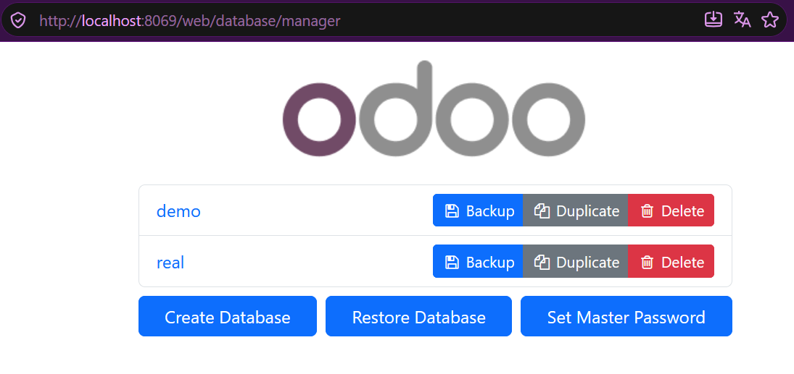

## 3. Ejercicio 1: Tipos de producto e impuestos

Tras instalar la aplicación **Inventario**, Odoo 19 permite distinguir las cuatro variantes de producto según su tipo y control de existencias:

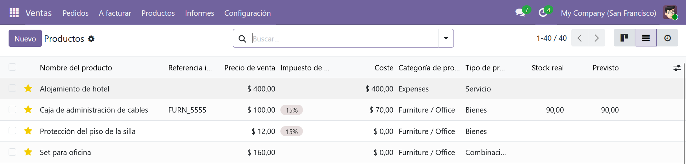

- **Bienes (con Rastrear inventario):** _Caja de administración de cables_ (`FURN_5555`) — Impuesto de ventas: `15%`.

  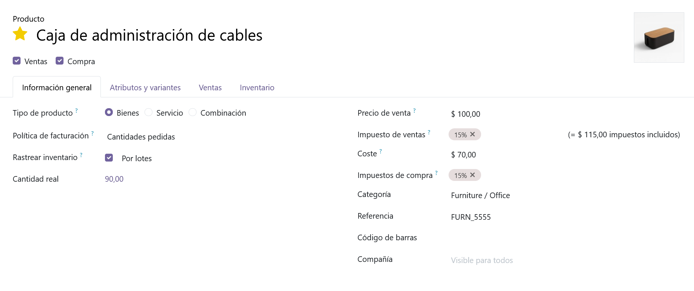

- **Bienes (sin Rastrear inventario):** _Protección del piso de la silla_ — Impuesto de ventas: `15%` / Impuesto de compras: `15%`.

  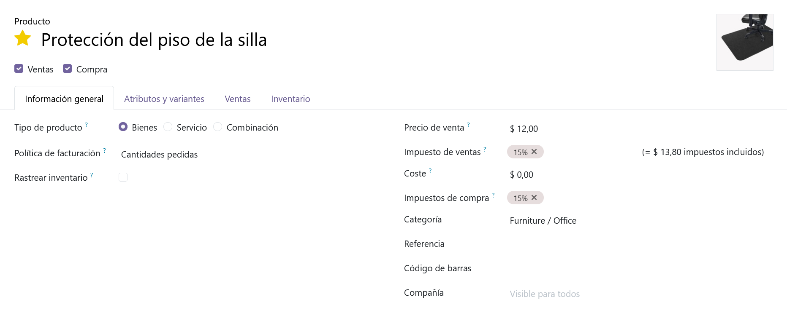

- **Servicio:** _Alojamiento de hotel_ — Sin impuestos asignados por defecto.

  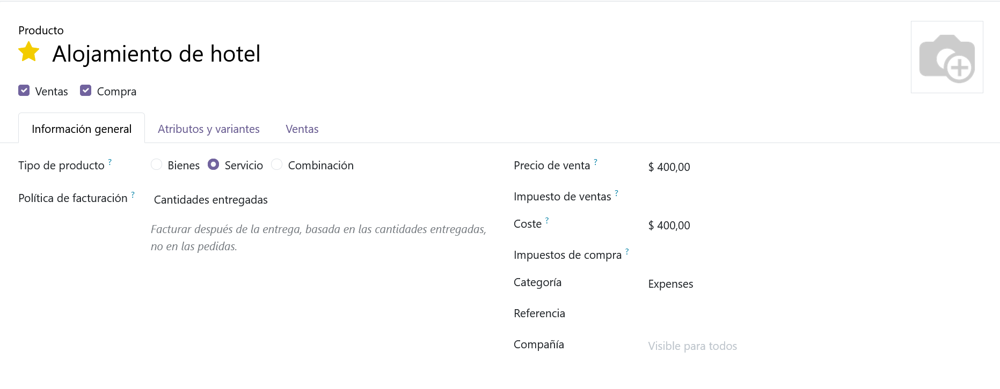

- **Combinación:** _Set para oficina_ — Sin impuestos asignados por defecto.

  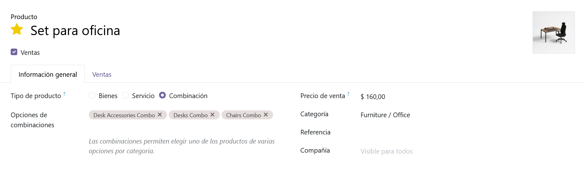

## 4. Ejercicio 2: Recorrido del cliente a la factura pagada

1. **Contactos (Compañía vs. Individuo):** Los contactos de tipo _Individuo_ quedan vinculados a su _Compañía_ heredando los datos fiscales y la dirección comercial de la empresa.

   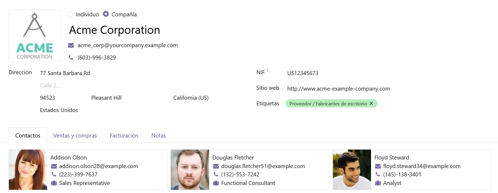

2. **Alta de cliente:** Creada la compañía _Sistemas Atlántico S.L._ con dirección completa en España, NIF intracomunitario válido (`ESB36842151`) y etiqueta asignada.

   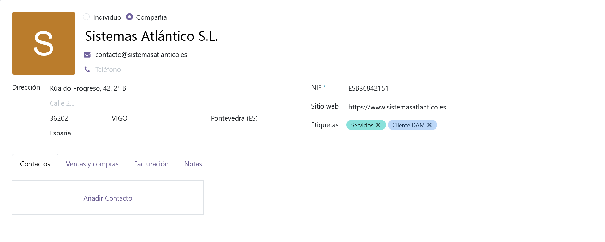

3. **Alta de productos:** Creados el servicio _Hora de soporte_ (40,00 €, IVA ventas 21%) y el bien _Libro técnico_ (25,00 €, IVA ventas 4%), ambos habilitados para _Ventas_.

   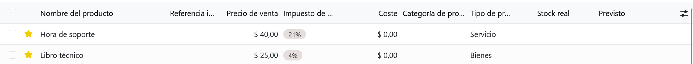

4. **Presupuesto y pedido de venta:** Presupuesto creado para _Sistemas Atlántico S.L._ con ambos productos, enviado por correo electrónico y confirmado, pasando a estado **Pedido de venta**.

   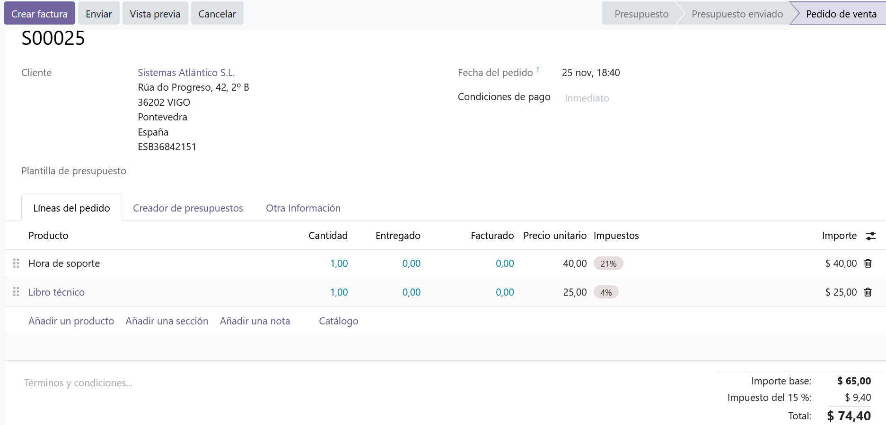

5. **Facturación, PDF y pago:** Factura generada desde el pedido comprobando el desglose de IVA por línea (`21%` y `4%`), confirmada, descargada en PDF y marcada con la cinta **Pagado** tras registrar el cobro.

   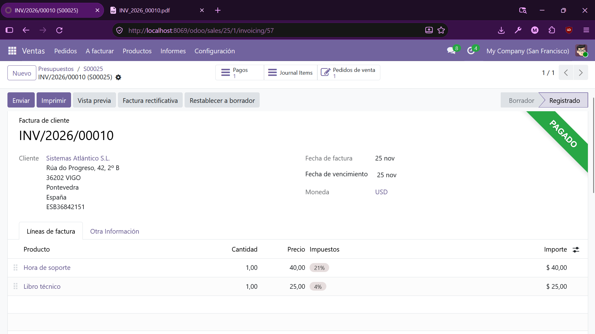

6. **Comparativa con factura de proveedor:** A diferencia de la factura de cliente (que emplea diario de ventas, cuentas de ingresos e IVA repercutido), la factura de proveedor utiliza diario de compras, cuentas contables de gasto e IVA soportado.

   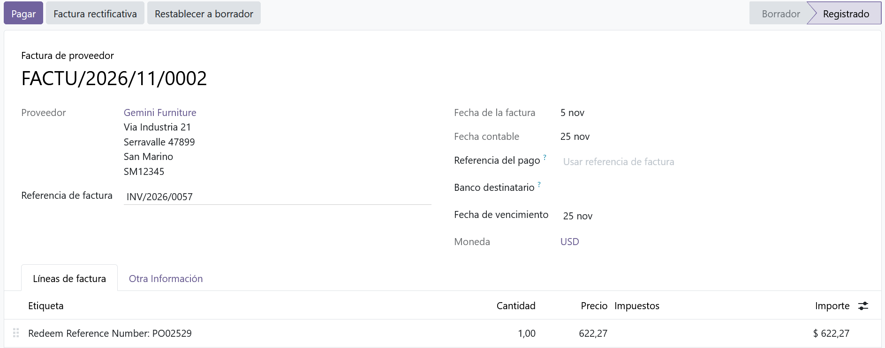

7. **Actividad en el Chatter:** Planificada una actividad de tipo _Llamada_ desde el historial lateral de la ficha del cliente.

   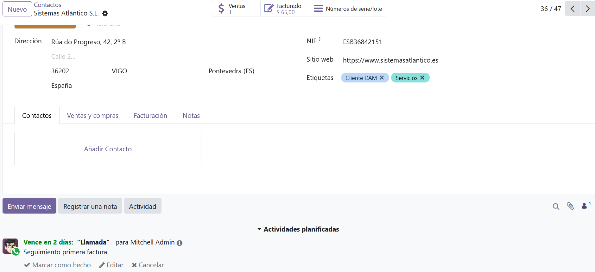

## 5. Ejercicio 3: Búsqueda guardada

En _Facturación → Clientes → Facturas_, configurada la **vista lista** filtrando por estado **Registrado (Publicadas)**, agrupando por **Socio (Cliente)** y guardando la vista en **Favoritos**.

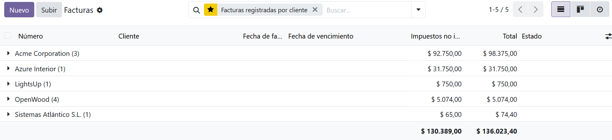

## 6. Ejercicio 4: Modo desarrollador

Activado mediante las dos vías principales (desde _Ajustes → Herramientas de desarrollador_ y añadiendo el parámetro `?debug=1` en la URL, comprobando la aparición del icono del escarabajo en la barra superior):

**Vía Ajustes:**

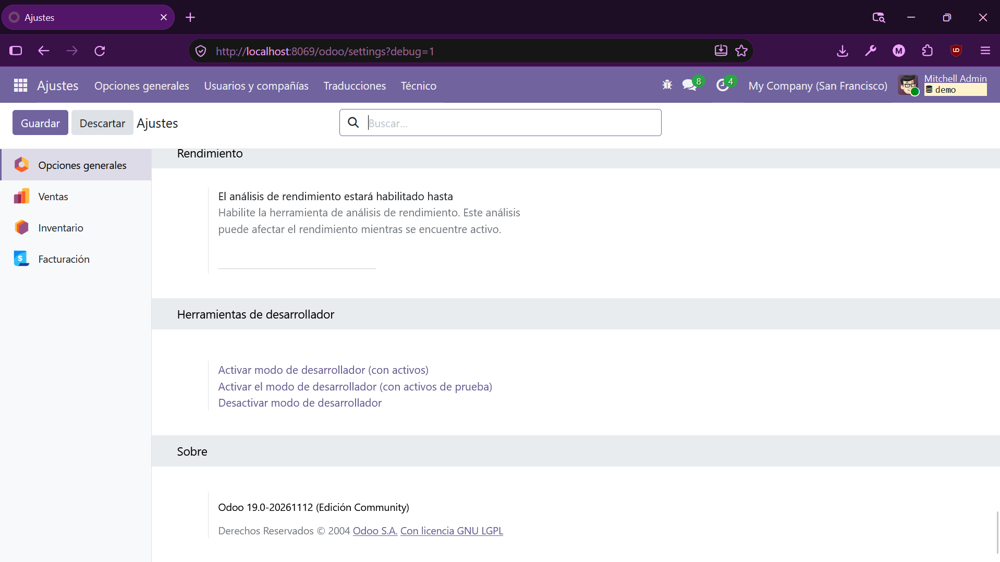

**Vía URL (`?debug=1`):**

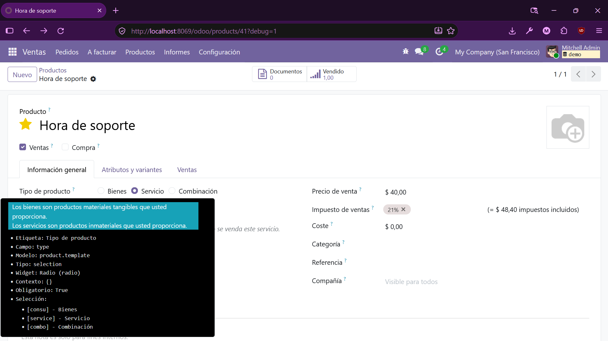

| Elemento inspeccionado | Etiqueta visible   | Nombre técnico / Modelo        |
| ---------------------- | ------------------ | ------------------------------ |
| Campo 1 (Contacto)     | NIF / CIF          | `vat` (modelo `res.partner`)   |
| Campo 2 (Contacto)     | Correo electrónico | `email` (modelo `res.partner`) |
| Registro de factura    | Factura de cliente | Modelo `account.move`          |

## 7. Incidencias

| Fecha      | Síntoma                                                                  | Causa                                                                                                              | Solución                                                                                                      |
| ---------- | ------------------------------------------------------------------------ | ------------------------------------------------------------------------------------------------------------------ | ------------------------------------------------------------------------------------------------------------- |
| 24/11/2026 | Error de parseo en `.env` al ejecutar `docker compose`                   | La guía contenía símbolos `$` erróneos en `ODOO_TAG $TAG=19.0$` y `ODOO_PORT $=8069$`                              | Corregir las variables a `ODOO_TAG=19.0` y `ODOO_PORT=8069`                                                   |
| 24/11/2026 | El contenedor `odoo` falla al iniciar leyendo `odoo.conf`                | Falta el carácter `=` en la directiva `list_db True` del ejemplo de la guía                                        | Cambiar la línea a `list_db = True`                                                                           |
| 24/11/2026 | Error de validación YAML en `docker-compose.yml`                         | Bloque `depends_on:` del servicio `pgadmin` mal indentado junto a `volumes:`                                       | Indentar correctamente `- db` bajo `depends_on:` en `pgadmin`                                                 |
| 25/11/2026 | Error de validación al guardar el NIF del nuevo cliente (`B36842159`)    | Al indicar país _España_, el módulo `base_vat` exige prefijo intracomunitario `ES` y dígito de control exacto      | Introducir el NIF con prefijo y dígito de control válido (`ESB36842151`)                                      |
| 25/11/2026 | Ausencia de impuestos IVA del `21%` y `4%` en la base de datos `demo`    | Al marcar _Datos de demostración_, Odoo carga la compañía de muestra de EE. UU. con impuestos del `15%`            | Dar de alta manualmente los impuestos de ventas del `21%` y `4%` en _Facturación → Configuración → Impuestos_ |
| 25/11/2026 | Nombres de filtro distintos en el Ejercicio 3 (`Publicadas` / `Cliente`) | En la traducción de Odoo 19, el estado publicado figura como _Registrado_ y la agrupación por cliente como _Socio_ | Aplicar el filtro _Registrado_ y agrupar por _Socio_ antes de guardar en _Favoritos_                          |

## 8. Declaración de uso de IA

- **Herramienta:** Gemini.
- **Uso:** Resolución de errores de sintaxis en los ficheros de despliegue, diagnóstico de validaciones fiscales/impuestos en Odoo 19 y estructuración de la documentación en Markdown.
- **Modificaciones realizadas:** Se han adaptado los comandos al entorno local, ejecutado manualmente todos los pasos funcionales en Odoo 19, obtenido las capturas propias y verificado todos los nombres técnicos sobre la instancia desplegada.
